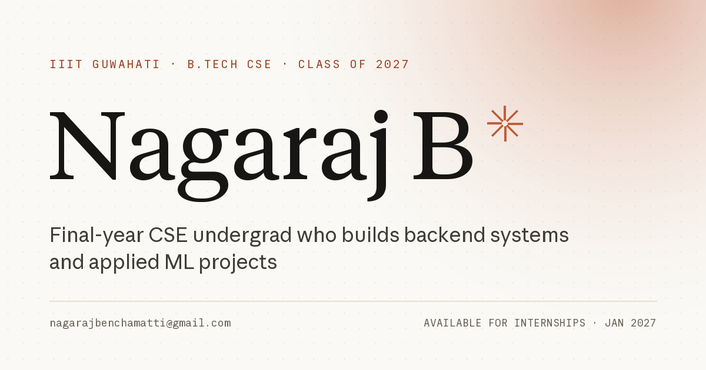

# Nagaraj B — portfolio

**Live:** [nagaraj0000b.github.io](https://nagaraj0000b.github.io/) ·
**Repo:** [github.com/Nagaraj0000b/Nagaraj0000b.github.io](https://github.com/Nagaraj0000b/Nagaraj0000b.github.io)

A single-page developer portfolio. Plain HTML/CSS/JS, no build step, no
dependencies, no external requests. Deployable as-is to GitHub Pages, Vercel or
Netlify.



**Contents**

- [Run it locally](#run-it-locally)
- [Deploy](#deploy)
- [Customize](#customize)
  - [Screenshots](#screenshots)
  - [Demo clips](#demo-clips)
  - [Resume](#resume)
  - [Links & content](#links--content)
  - [Colors & type](#colors--type)
  - [Fonts & licensing (important)](#fonts--licensing-important)
  - [Social preview image](#social-preview-image)
- [Motion & interactions](#motion--interactions)
- [Accessibility](#accessibility)
- [Performance](#performance)
- [File map](#file-map)

---

## Run it locally

Open `index.html` in a browser, or serve the folder (recommended so fonts and
relative paths behave exactly like production):

```sh
cd portfolio
python -m http.server 8080
# http://localhost:8080
```

No install, no build, no package manager.

## Deploy

The whole site is static: `index.html`, `styles.css`, `script.js` and `assets/`.
The folder already contains a `.nojekyll` file for GitHub Pages.

The live site is deployed from the `main` branch of
[`Nagaraj0000b/Nagaraj0000b.github.io`](https://github.com/Nagaraj0000b/Nagaraj0000b.github.io)
(root of the repository, GitHub Pages "Deploy from a branch" → `main` → `/`).

If you ever move it to a different repo or host:

### GitHub Pages

1. Copy the **contents** of this folder to your site repository (root, or a
   `/docs` folder if you prefer), then commit and push.
2. On GitHub: **Settings → Pages → Build and deployment**.
   - Source: *Deploy from a branch*
   - Branch: `main` + `/ (root)` (or `/docs`)
3. Every asset path is relative, so the site works from a user site
   (`https://Nagaraj0000b.github.io`) or a project site
   (`https://Nagaraj0000b.github.io/<repo>/`).

### Vercel

- Dashboard: import the repo → **Root Directory** = `portfolio` (or the repo root
  if you copied the files there) → **Framework Preset** = *Other* → deploy.
- CLI: `cd portfolio && vercel --prod`.

### Netlify

- Drag the `portfolio` folder onto **https://app.netlify.com/drop**, or
- Connect the repo with **Build command** empty and **Publish directory** =
  `portfolio` (or the folder where you copied the files).

No environment variables, no server, no rewrite rules needed.

## Customize

### Screenshots

Every project card has a replaceable screenshot slot. Current placeholders live at:

| Project | Placeholder | Replace with |
| --- | --- | --- |
| KVix | `assets/shots/kvix.svg` | `assets/shots/kvix.png` (or `.webp`) |
| Where Is My Bus | `assets/shots/where-is-my-bus.svg` | `assets/shots/where-is-my-bus.png` |
| Saarthi | `assets/shots/saarthi.svg` | `assets/shots/saarthi.png` |

1. Drop your image into `assets/shots/`. Use **16:10**, ideally
   **1600 × 1000 px**, PNG/WebP under ~300 KB.
2. In `index.html`, update the three `` `src` values and their
   `alt` text (search for `SCREENSHOT SLOT`).
3. If a file is missing, the card shows a striped "Screenshot missing" fallback
   instead of a broken-image icon.

You can also keep the filename and replace the SVG only if your new asset is
also an SVG — for PNG/WebP, update the `src`.

### Demo clips

Each card has a **Demo clip** link. They intentionally point to `#` and show a
small toast until you add real URLs:

- Open `index.html` and find `data-demo="KVix"`, `data-demo="Where Is My Bus"`,
  `data-demo="Saarthi"`.
- Replace `href="#"` with your YouTube / Loom / Google Drive video URL. The
  toast only intercepts links whose `href` is still `#`.

### Resume

The included file is your resume PDF: `assets/Nagaraj-B-Resume.pdf`. Three links
point to it (header, hero, footer). The simplest update is to replace the file
with a new PDF of the same name. Otherwise update the three `href`s in
`index.html`.

### Links & content

Already wired to your real profiles from your resume:

- GitHub — `https://github.com/Nagaraj0000b`
- LinkedIn — `https://linkedin.com/in/nagarajb1`
- Email — `nagarajbenchamatti@gmail.com`
- Repos — `Kvix`, `where-is-my-bus`, `Saarthi-Ai`
- Codeforces — `https://codeforces.com/profile/nagaraj14567` (Pupil, 1309)
- LeetCode — `https://leetcode.com/u/Nagaraj00B/`
- CodeChef — `https://www.codechef.com/users/nagaraj23b` (3★, 1715)

Project descriptions, metrics, achievements and the skills list are in
`index.html`. Keep the numbers as written — they are the ones from your prompt
and resume. Update the JSON-LD `Person` block in `<head>` if you change social
links.

### Colors & type

All design tokens live at the top of `styles.css`:

```css
:root {
  --paper: #faf9f5;   /* page background */
  --ink: #171614;     /* text */
  --accent: #c15f3c;  /* the single clay accent */
  --serif / --sans / --mono  /* font stacks */
}
```

Changing `--accent` alone re-skins the page (hover states use the darker
`--accent-2`, so update both if you switch hue families).

### Fonts & licensing (important)

The site self-hosts three **Anthropic** typefaces:

| Token | File | Used for |
| --- | --- | --- |
| `--serif` | `assets/fonts/AnthropicSerifWebText.ttf` | name, headings, numbers |
| `--sans` | `assets/fonts/AnthropicSansWebText.ttf` | body/UI |
| `--mono` | `assets/fonts/AnthropicMonoVariable.ttf` | labels, tags, metadata |

These are **proprietary fonts** (© Anthropic PBC). They are fine for local,
personal preview, but publishing this folder makes them publicly downloadable,
which is redistribution and is not permitted without Anthropic's permission.
See [`assets/fonts/NOTICE.md`](assets/fonts/NOTICE.md).

If you deploy publicly without a license for these fonts, swap to freely
licensed lookalikes. Closest match to the current look (all OFL, self-hostable
via Fontsource or Google Fonts):

- Serif: **Source Serif 4** (closest to Anthropic Serif / Tiempos); alternatives
  *Newsreader*, *Literata*
- Sans: **Inter** or **Archivo**
- Mono: **JetBrains Mono** or **IBM Plex Mono**

To switch, delete the three `@font-face` blocks at the top of `styles.css`,
delete the `.ttf` files, add the web fonts however you prefer, and update:

```css
:root {
  --serif: "Source Serif 4", Georgia, "Times New Roman", serif;
  --sans: "Inter", -apple-system, BlinkMacSystemFont, "Segoe UI", Helvetica, Arial, sans-serif;
  --mono: "JetBrains Mono", ui-monospace, "SF Mono", Consolas, monospace;
}
```

Then remove the two font `<link rel="preload">` tags from `index.html`.

### Social preview image

`assets/og.png` (1200 × 630) is generated from the same type and palette. It is
referenced with absolute URLs (`https://nagaraj0000b.github.io/assets/og.png`),
and `og:url` / the canonical link point at the live site. If you move to a custom
domain, update the canonical link, `og:url`, `og:image`, `twitter:image` and the
JSON-LD `url`.

## Motion & interactions

All motion is CSS transform/opacity driven and repeats — it is not a one-time
entrance animation:

- **Scroll reveals re-arm.** Every section re-hides after it leaves the viewport
  and animates back in on each visit (IntersectionObserver for normal variants,
  scroll geometry for the clipped "mask" headings).
- **Hero intro** plays on load and is replayable: click the **N monogram** in the
  header (it also scrolls back to the top).
- **Ambient loop** — the clay spark rotates, the status dot pulses, an accent
  glow drifts, the outlined scroll cue loops.
- **Marquee** — the keyword strip scrolls forever (pauses on hover).
- **Project cards** tilt toward the pointer with a cursor-tracking clay spotlight,
  image zoom and tag states. Disabled on touch and coarse pointers.
- **Counters** count up on each entry into view and reset when they leave.
- **Navigation** has a sliding active pill, scroll progress bar and mobile sheet
  with staggered links.
- **Hover/focus** underline sweeps, arrow nudges, chip lift, footer email
  underline draw.

Motion is controlled by:

1. `prefers-reduced-motion: reduce` — animations, marquee, tilt and counters are
   disabled and content renders immediately.
2. The **Reduce motion** switch in the footer — persists in `localStorage` and
   overrides the system setting for this site only (including turning motion
   back on when the OS asks for reduced motion).

There is no scroll hijacking, no custom smooth-scroll library, no cursor
replacement, and no animation library. Smooth anchor scrolling uses native
`scroll-behavior` (turned off for reduced motion). A manual scroll restoration
keeps every fresh load/reload at the hero; `#section` links still jump normally.

## Accessibility

- Skip link, landmarks (`header/main/footer`), one `h1`, ordered headings,
  `aria-labelledby` on sections, `aria-current` on the active nav link.
- Keyboard: menu toggles with Enter/Space, traps Tab, closes on `Esc`, moves focus
  back to the toggle; background becomes `inert` while the sheet is open.
- Touch targets are at least 44 px on small screens.
- Decorative elements are `aria-hidden`; animated counters have a static
  screen-reader twin, so the final value is what assistive tech reads.
- External `target="_blank"` links announce "(opens in new tab)".
- Content is readable without JavaScript (reveal styles are gated behind a `js`
  class; a timed fallback also reveals everything if the script fails).
- Text contrast targets WCAG AA: ink on paper is ~16:1, secondary text ~5.5:1,
  the clay accent text on paper ~6:1. The bright clay is only used for large
  display numbers/marks and decorative borders.
- Print stylesheet included for a clean paper version.

## Performance

- **~310 KB first load**, fonts included (220 KB of that is the three typefaces);
  the resume PDF is only fetched when clicked. No external network requests, no
  frameworks, no analytics, no cookies.
- Fonts are self-hosted and the two primary faces are preloaded with
  `font-display: swap`; the mono face loads on demand.
- Screenshots are vector placeholders now, loaded lazily; replace with
  compressed WebP/PNG to keep the page light.
- Animations animate `opacity`/`transform` only and are paused for reduced-motion
  users, so scrolling stays at 60 fps on mid-range phones.

## File map

```
portfolio/
├── index.html                 # all content
├── styles.css                 # design tokens + layout + transitions
├── script.js                  # reveal engine, tilt, counters, nav, menu, motion switch
├── .nojekyll                  # GitHub Pages: skip Jekyll
├── README.md                  # this file
└── assets/
    ├── Nagaraj-B-Resume.pdf   # replace with your latest resume (same filename)
    ├── favicon.svg
    ├── apple-touch-icon.png
    ├── og.png                 # 1200×630 social preview
    ├── fonts/
    │   ├── AnthropicSerifWebText.ttf
    │   ├── AnthropicSansWebText.ttf
    │   ├── AnthropicMonoVariable.ttf
    │   └── NOTICE.md          # font licensing / replacement instructions
    └── shots/
        ├── kvix.svg           # screenshot placeholders — replace
        ├── where-is-my-bus.svg
        └── saarthi.svg
```

## Notes

- **Privacy:** the resume PDF is public once the site is deployed, and the
  included one contains your phone number. Remove it from the PDF (or from the
  site) if you don't want it public.
- Ratings/ranks on Codeforces and CodeChef drift over time — update the numbers
  in `index.html` when they change.
- No browser storage is used for anything except the motion preference.
- If you rename the repo or add a domain, update the absolute OG URLs and
  (optionally) add `og:url` plus a canonical `<link>`.
- The site was visually verified at 320, 375, 414, 768, 1024, 1280, 1440 and
  1920 px widths with keyboard, mobile-menu, reduced-motion and no-console-error
  checks.
